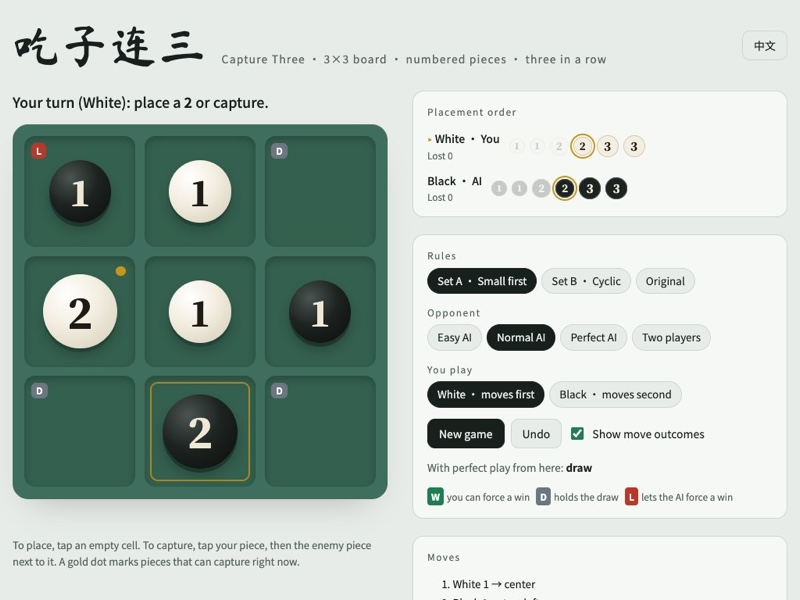

# Capture Three · 吃子连三

**English** | [中文](README.zh-CN.md)

Tic-tac-toe where every piece carries a number and can capture its neighbors. The game is small enough to solve completely with minimax. The solver shows that the original rules are a forced win for the first player. Changing three rules makes perfect play a draw. The repository includes a browser version where you play against an AI at three levels, the strongest of which never loses, or against a friend on the same screen.



## Play

Play online at **[https://lew1swong.github.io/Tic-Tac-Toe_Plus/](https://lew1swong.github.io/Tic-Tac-Toe_Plus/)**, or open `index.html` in a browser. It is a single file and works offline. When online, it loads web fonts from Google Fonts without blocking the page; where Google is slow or unreachable, it falls back to system fonts.

The page has a 中文 / English switch, three rule sets, and four opponents: Easy, Normal and Perfect AI, or two players taking turns on one screen. Against the AI you choose White or Black. There is also undo and a hint mode, which labels every legal move with its outcome under perfect play.

Stones are drawn in three sizes, so a 3 looks bigger than a 2 or a 1, like the wooden pieces in the video that inspired the game.

The Perfect AI searches every position to the end of the game. Easy and Normal play a random legal move 50% and 20% of the time, and always take an immediate three in a row. Against a perfect player in Set A, Easy loses about 85% of games and Normal about half; the rest are draws.

## Rules

### Set A (recommended)

1. The board is 3×3. **White moves first.**
2. Each player has six pieces: 1, 1, 2, 2, 3, 3. They are **placed in the order 1→1→2→2→3→3**.
3. On your turn, do one thing. Either place your next piece on an empty cell, or use one of your pieces to capture an adjacent enemy piece.
4. **Bigger captures smaller.** A 3 captures a 2 or a 1, and a 2 captures a 1. Equal numbers cannot capture each other.
5. **Diagonals count as adjacent**, so all 8 surrounding cells are neighbors.
6. **The capturing piece stays put.** The captured piece leaves the game.
7. Three of your pieces in a row, column or diagonal wins immediately.
8. If you have no legal move, you pass. If neither player can move, the game is a draw.

The game always ends. Each player places at most six pieces, and every capture removes a piece for good.

### Set B

Set B is also a draw with perfect play. It differs from Set A in two rules:

- Pieces are placed in the order 3→3→2→2→1→1.
- Captures are **cyclic**: 3 captures 2, 2 captures 1, and 1 captures 3.

### Original rules

The starting point used the order 3→3→2→2→1→1 and "bigger captures smaller". Only up, down, left and right counted as adjacent. A capturing piece moved onto the captured piece's cell.

## What the solver found

### The original game is a forced win for White

White wins with perfect play from any first move. Opening with 3 in the center wins within 3 more White moves:

```
1. White 3 → center
2. Black 3 → top-left       Black's longest defense
3. White 3 → top            threatens top, center, bottom
4. Black 3 → bottom         forced block; both Black 3s are now used
5. White 2 → bottom-left    threatens top-right, center, bottom-left
6. Black 2 → top-right      only a 2 is left to block with
7. White's 3 on top captures that 2 and moves to top-right. Three in a diagonal, White wins.
```

Black has only two 3s. Once they are used, any 2 or 1 that blocks next to a White 3 can be captured.

White's chances after opening with 3 in the center:

| How the players move | White wins |
|---|---|
| Both play perfectly | 100% |
| White perfect, Black random | 100% |
| Both random | 71.3% |
| White random, Black perfect | 3.7% |

The verbal rules left room for interpretation, so all four readings were solved. The center opening wins in every one:

| Adjacency | Capture | Result | Extra White moves to win | Both random, White wins |
|---|---|---|---|---|
| 4-way | capturer moves | White wins | 3 | 71.3% |
| 8-way | capturer moves | White wins | 3 | 70.3% |
| 4-way | capturer stays | White wins | 7 | 65.5% |
| 8-way | capturer stays | White wins | 7 | 64.1% |

With 8-way adjacency, the center is White's only winning first move. Every other opening loses.

### Making it fair

Twenty rule combinations were solved from the empty board. "Random play" means both sides pick uniformly random legal moves.

| Rule combination | Perfect play | White first moves win / draw / loss | Random play White / draw / Black |
|---|---|---|---|
| 4-way · move · 1→3 · bigger wins | White wins | 9 / 0 / 0 | 62.4% / 1.0% / 36.6% |
| 4-way · move · 1→3 · cyclic | White wins | 9 / 0 / 0 | 62.1% / 1.2% / 36.6% |
| 4-way · move · 3→1 · bigger wins | White wins | 9 / 0 / 0 | 62.6% / 2.3% / 35.1% |
| 4-way · move · 3→1 · cyclic | White wins | 9 / 0 / 0 | 62.7% / 1.7% / 35.5% |
| 4-way · stay · 1→3 · bigger wins | White wins | 4 / 5 / 0 | 57.9% / 8.0% / 34.1% |
| 4-way · stay · 1→3 · cyclic | White wins | 9 / 0 / 0 | 57.6% / 7.4% / 35.0% |
| 4-way · stay · 3→1 · bigger wins | White wins | 9 / 0 / 0 | 57.0% / 8.8% / 34.2% |
| 4-way · stay · 3→1 · cyclic | White wins | 8 / 1 / 0 | 57.6% / 8.1% / 34.3% |
| 8-way · move · 1→3 · bigger wins | White wins | 9 / 0 / 0 | 62.0% / 2.3% / 35.6% |
| 8-way · move · 1→3 · cyclic | White wins | 9 / 0 / 0 | 61.7% / 3.1% / 35.2% |
| 8-way · move · 3→1 · bigger wins | White wins | 1 / 0 / 8 | 61.7% / 5.5% / 32.9% |
| 8-way · move · 3→1 · cyclic | White wins | 9 / 0 / 0 | 62.0% / 4.4% / 33.6% |
| 8-way · stay · 1→3 · bigger wins | **Draw** | 0 / 9 / 0 | 55.6% / 10.9% / 33.5% |
| 8-way · stay · 1→3 · cyclic | White wins | 5 / 4 / 0 | 54.8% / 11.9% / 33.3% |
| 8-way · stay · 3→1 · bigger wins | White wins | 1 / 0 / 8 | 53.6% / 14.8% / 31.6% |
| 8-way · stay · 3→1 · cyclic | **Draw** | 0 / 9 / 0 | 54.2% / 13.8% / 32.0% |
| 4-way · move · 3→1 · bigger wins · no center first | White wins | 8 / 0 / 0 | 61.5% / 2.4% / 36.1% |
| 4-way · move · 3→1 · bigger wins · captures cannot win | White wins | 9 / 0 / 0 | 60.4% / 4.7% / 34.9% |
| 8-way · move · 3→1 · bigger wins · no center first | Black wins | 0 / 0 / 8 | 60.6% / 5.6% / 33.8% |
| 8-way · move · 3→1 · bigger wins · captures cannot win | White wins | 1 / 0 / 8 | 58.1% / 9.6% / 32.3% |

What the table shows:

- **One change is never enough.** Diagonal adjacency, capture-in-place, reversed order, cyclic capture, banning a center opening, or forbidding wins by capture each leave a first-player win on their own.
- **Diagonal adjacency plus capture-in-place is the core.** Both fair sets contain this pair, plus one more change: the 1→3 order for Set A, or cyclic capture for Set B.
- **Some fixes overshoot.** With 8-way adjacency, banning White's center opening turns the game into a forced win for Black.
- **Free placement order was not tested.** Letting players place any remaining piece makes the game tree too large for the pure-Python solver.

### Skill still matters

A drawn game can still be dull if the draw is easy to hold. These numbers show it is not:

| | Original | Set A | Set B |
|---|---|---|---|
| Perfect play | White wins | Draw | Draw |
| Perfect White vs random Black | White wins 100% | White wins 99.99% | White wins 100% |
| Random White vs perfect Black | Black wins 99.2% | Black wins 99.0% | Black wins 99.9% |
| Average plies in a random game | 8.9 | 9.9 | 10.6 |
| Mistakes per random game | 2.7 | 4.2 | 4.1 |
| Black replies that hold vs a center opening | 0 of 8 | 4 of 8 | 4 of 8 |
| Black replies that hold vs a corner opening | 0 of 8 | 1 of 8 | 1 of 8 |

A mistake is a move that makes the mover's result worse under perfect play, such as turning a draw into a loss. Against a corner opening in either fair set, Black must take the center.

## How it works

- **State.** A position is the 9 cells (empty, or a piece worth ±1 to ±3), how many pieces each player has placed, and the side to move. Positions cannot repeat, so plain memoized minimax is exact.
- **Analysis.** `analysis/` contains the Python solvers. Win rates under random play are exact, computed by averaging the same recursion over all legal moves.
- **Browser AI.** `src/engine.js` runs the same search in a Web Worker. It uses an open-addressing hash table on typed arrays. Solving the whole game from the empty board takes about 0.4 s for Set A and 0.9 s for Set B.
- **Choosing among equal moves.** When the AI is winning, it picks the fastest win. When the position is a draw, it picks the drawing move that leaves you the most losing replies.

## Repository layout

```
index.html                   the playable game, generated by src/build.py
src/page.html                page template: layout, styles, Chinese and English text
src/engine.js                solver used by the page and by the tests
src/build.py                 inlines the engine into the template
analysis/solve_original.py   original rules: center opening, win rates, forced line
analysis/variants.py         solves the rule combinations, one JSON line each
analysis/detail.py           skill and mistake metrics for the fair sets
analysis/results.jsonl       the results shown above
tests/test_engine.js         checks the JS engine against the Python results
tests/test_ai.js             the AI against a random player, 300 games per side and rule set;
                             Easy and Normal against a perfect player
docs/                        screenshots
```

## Running

Python 3 with only the standard library, and Node.js for the tests.

```bash
python3 src/build.py
node tests/test_engine.js
node tests/test_ai.js
python3 analysis/solve_original.py --diag
python3 analysis/detail.py A
python3 analysis/variants.py > analysis/results.jsonl
```

The last command takes a few minutes.

## Inspiration

This project was inspired by an "Advanced Tic-Tac-Toe" video posted on Instagram by [@tomi.timetraveler](https://www.instagram.com/tomi.timetraveler/). In the video, two players use wooden pieces of three sizes on a tic-tac-toe grid. The rules here are a separate variant and may differ from the game shown in the video.
