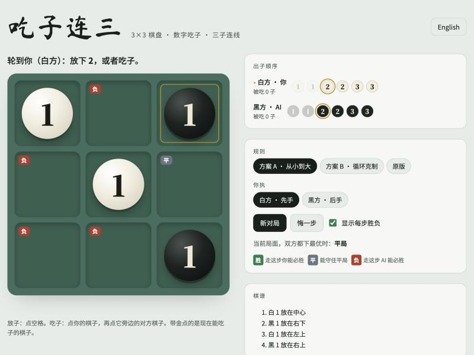

# 吃子连三 · Capture Three

[English](README.md) | **中文**

这是一个每个棋子都带数字、还能吃掉相邻棋子的井字棋。游戏很小，可以用 minimax 完全解出来。求解结果显示，原版规则是先手必胜。改动三条规则后，双方都下最优时变成平局。仓库里还有一个网页版，你可以和一个不会输的 AI 对战。



## 开始玩

用浏览器打开 `index.html` 就能玩。它是单个文件，没有任何依赖，离线也能用。想放到网上的话，在仓库设置里打开 GitHub Pages，从默认分支的根目录发布。

页面支持中英文切换，有三套规则可选，可以执白或执黑，还有悔棋和提示模式。打开提示后，每一步可走的位置都会标出双方最优下的结果。

## 规则

### 方案 A（推荐）

1. 棋盘是 3×3，**白方先走**。
2. 每人有六个子：1、1、2、2、3、3，**按 1→1→2→2→3→3 的顺序**放。
3. 每回合二选一：把下一个子放到空格上，或者用自己的一个子吃掉相邻的对方棋子。
4. **大吃小**：3 能吃 2 和 1，2 能吃 1，数字相同不能互吃。
5. **斜向也算相邻**，一个子周围的 8 个格子都算。
6. **吃子后原地不动**：被吃的子出局，吃子的那个子留在原位。
7. 自己的三个子连成横、竖或斜线，立即获胜。
8. 没有合法动作就跳过，双方都动不了算平局。

游戏一定会结束，因为每人最多放六个子，而每次吃子都会永久减少一个子。

### 方案 B

方案 B 在最优对弈下也是平局。它和方案 A 有两条不同：

- 出子顺序是 3→3→2→2→1→1。
- **循环克制**：3 吃 2，2 吃 1，1 吃 3。

### 原版规则

最初的规则是按 3→3→2→2→1→1 的顺序出子，大吃小。只有上下左右算相邻，吃子时吃子方移到被吃子的格子里。

## 求解结果

### 原版是白方必胜

无论白方第一步放在哪里，只要下对都能赢。3 放在中心的话，白方最多再走 3 步就能赢：

```
1. 白 3 → 中心
2. 黑 3 → 左上            黑方最顽强的应对
3. 白 3 → 上中            威胁 上中、中心、下中 这条竖线
4. 黑 3 → 下中            被迫去堵，黑方两个 3 都用完了
5. 白 2 → 左下            威胁 右上、中心、左下 这条斜线
6. 黑 2 → 右上            只剩 2 能拿来堵
7. 上中的白 3 吃掉右上的黑 2 并移过去，斜线连成，白胜。
```

黑方只有两个 3。两个 3 用完以后，黑方再用 2 或 1 去堵，只要这个子挨着白方的 3，就会被吃掉。

白方 3 开在中心时的胜率：

| 双方怎么下 | 白方胜率 |
|---|---|
| 双方都下最优 | 100% |
| 白方最优，黑方随机 | 100% |
| 双方都随机 | 71.3% |
| 白方随机，黑方最优 | 3.7% |

最初的口头规则有几处可以有不同理解，所以四种理解都解了一遍。中心开局在每一种理解下都是白方必胜：

| 相邻 | 吃子方式 | 结果 | 白方还要走几步 | 双方随机时白方胜率 |
|---|---|---|---|---|
| 4 方向 | 吃子方移过去 | 白必胜 | 3 | 71.3% |
| 8 方向 | 吃子方移过去 | 白必胜 | 3 | 70.3% |
| 4 方向 | 吃子方原地不动 | 白必胜 | 7 | 65.5% |
| 8 方向 | 吃子方原地不动 | 白必胜 | 7 | 64.1% |

如果斜向也算相邻，白方第一步只有放中心才能赢，放在其他任何格子都会输。

### 怎样变公平

从空棋盘开始，一共解了 20 种规则组合。"双方乱下"指双方每一步都从合法走法里均匀随机选。

| 规则组合 | 最优对弈 | 白方首手 胜 / 平 / 负 | 双方乱下 白胜 / 平 / 黑胜 |
|---|---|---|---|
| 4 方向 · 移动吃 · 1→3 · 大吃小 | 白必胜 | 9 / 0 / 0 | 62.4% / 1.0% / 36.6% |
| 4 方向 · 移动吃 · 1→3 · 循环 | 白必胜 | 9 / 0 / 0 | 62.1% / 1.2% / 36.6% |
| 4 方向 · 移动吃 · 3→1 · 大吃小 | 白必胜 | 9 / 0 / 0 | 62.6% / 2.3% / 35.1% |
| 4 方向 · 移动吃 · 3→1 · 循环 | 白必胜 | 9 / 0 / 0 | 62.7% / 1.7% / 35.5% |
| 4 方向 · 原地吃 · 1→3 · 大吃小 | 白必胜 | 4 / 5 / 0 | 57.9% / 8.0% / 34.1% |
| 4 方向 · 原地吃 · 1→3 · 循环 | 白必胜 | 9 / 0 / 0 | 57.6% / 7.4% / 35.0% |
| 4 方向 · 原地吃 · 3→1 · 大吃小 | 白必胜 | 9 / 0 / 0 | 57.0% / 8.8% / 34.2% |
| 4 方向 · 原地吃 · 3→1 · 循环 | 白必胜 | 8 / 1 / 0 | 57.6% / 8.1% / 34.3% |
| 8 方向 · 移动吃 · 1→3 · 大吃小 | 白必胜 | 9 / 0 / 0 | 62.0% / 2.3% / 35.6% |
| 8 方向 · 移动吃 · 1→3 · 循环 | 白必胜 | 9 / 0 / 0 | 61.7% / 3.1% / 35.2% |
| 8 方向 · 移动吃 · 3→1 · 大吃小 | 白必胜 | 1 / 0 / 8 | 61.7% / 5.5% / 32.9% |
| 8 方向 · 移动吃 · 3→1 · 循环 | 白必胜 | 9 / 0 / 0 | 62.0% / 4.4% / 33.6% |
| 8 方向 · 原地吃 · 1→3 · 大吃小 | **平局** | 0 / 9 / 0 | 55.6% / 10.9% / 33.5% |
| 8 方向 · 原地吃 · 1→3 · 循环 | 白必胜 | 5 / 4 / 0 | 54.8% / 11.9% / 33.3% |
| 8 方向 · 原地吃 · 3→1 · 大吃小 | 白必胜 | 1 / 0 / 8 | 53.6% / 14.8% / 31.6% |
| 8 方向 · 原地吃 · 3→1 · 循环 | **平局** | 0 / 9 / 0 | 54.2% / 13.8% / 32.0% |
| 4 方向 · 移动吃 · 3→1 · 大吃小 · 禁首手占中 | 白必胜 | 8 / 0 / 0 | 61.5% / 2.4% / 36.1% |
| 4 方向 · 移动吃 · 3→1 · 大吃小 · 吃子不能获胜 | 白必胜 | 9 / 0 / 0 | 60.4% / 4.7% / 34.9% |
| 8 方向 · 移动吃 · 3→1 · 大吃小 · 禁首手占中 | 黑必胜 | 0 / 0 / 8 | 60.6% / 5.6% / 33.8% |
| 8 方向 · 移动吃 · 3→1 · 大吃小 · 吃子不能获胜 | 白必胜 | 1 / 0 / 8 | 58.1% / 9.6% / 32.3% |

从表里可以看出：

- **只改一条规则永远不够。** 单独加斜向相邻、单独改原地吃子、单独反转出子顺序、单独加循环克制、单独禁止首手占中、单独禁止吃子获胜，白方都还是必胜。
- **斜向相邻加原地吃子是关键。** 两个公平方案都包含这两条，再加一条改动：方案 A 改成 1→3 的出子顺序，方案 B 加循环克制。
- **有的改法会改过头。** 斜向相邻时如果禁止白方首手占中，局面就变成黑方必胜。
- **自由选择出子顺序的版本没有测出来。** 如果允许任意选手里剩下的子，博弈树太大，纯 Python 求解器跑不完。

### 技术依然重要

如果平局太容易守住，游戏也会很无聊。下面的数据说明不是这样：

| | 原版 | 方案 A | 方案 B |
|---|---|---|---|
| 双方最优 | 白必胜 | 平局 | 平局 |
| 白方最优，黑方随机 | 白胜 100% | 白胜 99.99% | 白胜 100% |
| 白方随机，黑方最优 | 黑胜 99.2% | 黑胜 99.0% | 黑胜 99.9% |
| 一局随机对局的平均步数 | 8.9 | 9.9 | 10.6 |
| 一局随机对局里的失误数 | 2.7 | 4.2 | 4.1 |
| 白方中心开局时，黑方能守住的应对 | 8 种里 0 种 | 8 种里 4 种 | 8 种里 4 种 |
| 白方角上开局时，黑方能守住的应对 | 8 种里 0 种 | 8 种里 1 种 | 8 种里 1 种 |

"失误"指让自己在最优对弈下的结果变差的一步，比如把平局走成必败。在两个公平方案里，白方开在角上时，黑方必须抢中心。

## 实现方式

- **局面表示。** 一个局面由 9 个格子（空，或者 ±1 到 ±3 的棋子）、双方各放了几个子、轮到谁走组成。局面不可能重复出现，所以带记忆化的 minimax 就能得到精确结果。
- **分析脚本。** `analysis/` 里是 Python 求解器。随机对局下的胜率也是精确值，用同一套递归对所有合法走法取平均得到。
- **网页 AI。** `src/engine.js` 在 Web Worker 里跑同样的搜索，用的是基于定型数组的开放寻址哈希表。从空棋盘解完整个游戏，方案 A 大约 0.4 秒，方案 B 大约 0.9 秒。
- **同样好的走法怎么选。** AI 能赢时选最快赢的走法。局面是平局时，它选给你留下最多必败走法的那一步。

## 仓库结构

```
index.html                   可直接玩的游戏，由 src/build.py 生成
src/page.html                页面模板：布局、样式、中英文文案
src/engine.js                求解引擎，页面和测试共用
src/build.py                 把引擎嵌入模板
analysis/solve_original.py   原版规则：中心开局、胜率、必胜路线
analysis/variants.py         求解各种规则组合，每种输出一行 JSON
analysis/detail.py           公平方案的技术与失误指标
analysis/results.jsonl       上面表格用到的结果
tests/test_engine.js         对照 Python 结果检查 JS 引擎
tests/test_ai.js             AI 对随机玩家，每套规则每一方各 300 局
docs/                        截图
```

## 运行

需要 Python 3，只用标准库。测试需要 Node.js。

```bash
python3 src/build.py
node tests/test_engine.js
node tests/test_ai.js
python3 analysis/solve_original.py --diag
python3 analysis/detail.py A
python3 analysis/variants.py > analysis/results.jsonl
```

最后一条命令要跑几分钟。

## 灵感来源

这个项目的灵感来自 Instagram 博主 [@tomi.timetraveler](https://www.instagram.com/tomi.timetraveler/) 发的一个 "Advanced Tic-Tac-Toe" 视频。视频里两个人在井字棋格子上，用三种大小的木头棋子对弈。本仓库的规则是另一个变体，可能和视频里的玩法不同。
